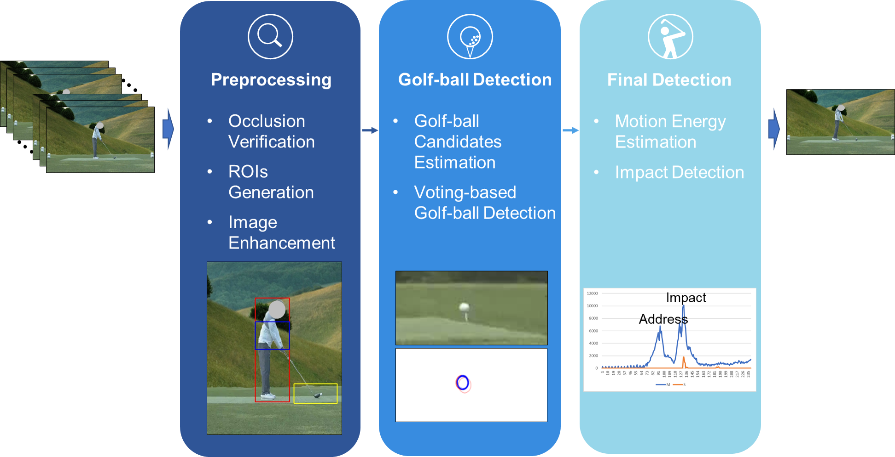

# golfBall (C++ / OpenCV)

Visual Studio C++ project for golf-ball related image/video processing.

The default entry point now runs improvement version 4 (v4), retaining unit-peak
Gaussian kernels. See [IMPROVEMENT_V4.md](IMPROVEMENT_V4.md) for the new stages,
validation provenance, and comparisons. v3 remains available at `improvement-v3`
and through `--profile v3` in the reproduction runner.
This is a method change from the submitted manuscript reconstruction (v1),
which is retained at tag `baseline-normalized-gaussian-v1`. See
[UNIT_PEAK_REVISION.md](UNIT_PEAK_REVISION.md) for the change and measured comparison.
See
[REPRODUCTION.md](REPRODUCTION.md) for build/run commands, segmentation, and
ground-truth evaluation, and [PAPER_ALIGNMENT.md](PAPER_ALIGNMENT.md) for the
audit and unresolved reproduction limits. The archived 97.30% is not yet a
verified result of the revised implementation.

## Preserved versions

The default branch contains improvement version 4. Previous implementations
remain available as immutable snapshots:

- [Original public code](https://github.com/Kijung-Kim/HIT-Fusion/tree/original-public-v0)
- [Manuscript reconstruction v1](https://github.com/Kijung-Kim/HIT-Fusion/tree/baseline-normalized-gaussian-v1)
- [Improvement version 2](https://github.com/Kijung-Kim/HIT-Fusion/tree/improvement-v2)
- [Improvement version 3](https://github.com/Kijung-Kim/HIT-Fusion/tree/improvement-v3)
- [Improvement version 4](https://github.com/Kijung-Kim/HIT-Fusion/tree/improvement-v4)

v4 uses unit-peak Gaussian voting followed by separate appearance support.
The submitted manuscript is unchanged; measured results and validation limits
are documented in [IMPROVEMENT_V4.md](IMPROVEMENT_V4.md).



## Repository Structure (recommended)

- Source/project files to keep:
  - `golfBall.sln`
  - `golfBall.vcxproj`
  - `golfBall.vcxproj.filters`
  - `*.cpp`, `*.h`
  - `yolo.cfg`
  - `yolo.weights` (or host separately and download)
- Ignored/generated files:
  - `.vs/`, `x64/`, `Debug/`, `Release/`
  - `*.user`, logs, result txt/csv, generated jpg files

## Prerequisites (Windows)

- Visual Studio 2019/2022 with **Desktop development with C++**
- OpenCV 3.4.x (x64, vc15/vc16 compatible)

Set environment variable:

```powershell
setx OpenCV_DIR "C:\opencv\opencv340\build"
```

Then reopen terminal/Visual Studio.

## Build (Visual Studio)

1. Open `golfBall.sln`
2. Select `x64` + `Release` (or `Debug`)
3. Build solution

## Runtime notes

- Program expects `yolo.cfg` and `yolo.weights` in working directory (project root by default)
- If OpenCV DLL is not found at runtime, add `%OpenCV_DIR%\x64\vc15\bin` to `PATH`.

## Large file note

`yolo.weights` is large (~200MB). If push fails on GitHub, use Git LFS:

```bash
git lfs install
git lfs track "*.weights"
```

